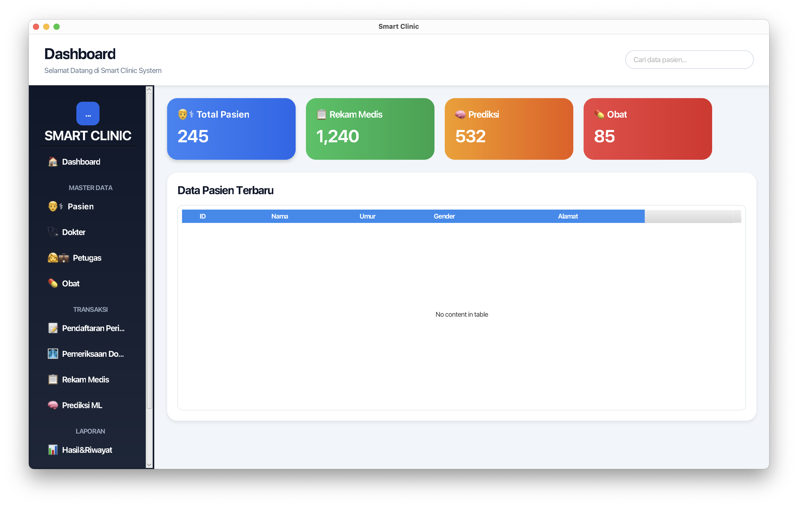
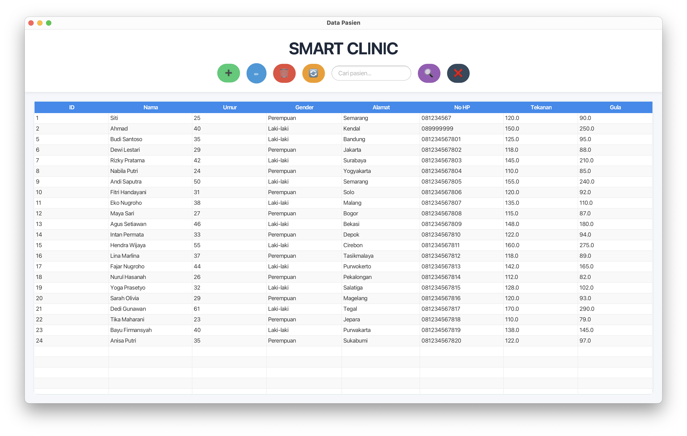
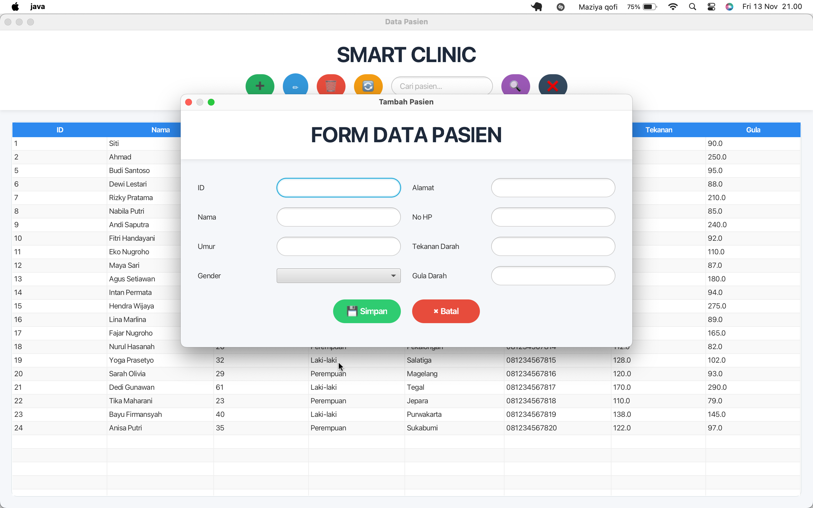

# SmartClinic – Clinic Management System

SmartClinic is a desktop-based clinic management application developed using Java and JavaFX, with MySQL as its relational database.

The application is designed to support basic clinic operations through a graphical user interface, including patient data management and clinic administration.

## Features

- Dashboard interface
- Patient management
- Patient registration data layer
- Database integration using MySQL
- JavaFX-based desktop interface

*Note: Features are documented according to the currently implemented version.*

## Technology Stack

| Technology | Purpose |
|---|---|
| Java 25 | Programming language |
| JavaFX 26 | Desktop UI framework |
| MySQL | Relational database |
| JDBC | Database connectivity |
| MySQL Connector/J | MySQL driver |

## Project Structure

```text
SmartClinic/
├── src/
├── lib/
├── screenshots/
├── smartClinic.sql
├── run_app.sh
├── README.md
└── .gitignore
```

## Application Screenshots

### Dashboard



### Patient Management



### Patient Form



## Requirements

- JDK 25 or compatible version
- JavaFX SDK 26
- MySQL Server
- MySQL Connector/J 9.6.0

## Installation and Setup

1. Clone the repository:

```bash
git clone https://github.com/maziyaqofi/SmartClinic.git
cd SmartClinic
```

2. Create the database and import the SQL file:

```bash
mysql -u root -p < smartClinic.sql
```

3. Configure the database connection in `DBConnection.java` according to your local MySQL setup.

4. Run the application:

```bash
chmod +x run_app.sh
./run_app.sh
```

## Development Notes

This repository contains the latest maintained version of the SmartClinic project. Some modules from earlier development iterations may not be included in the current implementation.

## Author

Maziya Qofi
Naf'an Nur'Alim (Team Member)

GitHub: [@maziyaqofi](https://github.com/maziyaqofi)

---

*Developed as a Java desktop application project.*